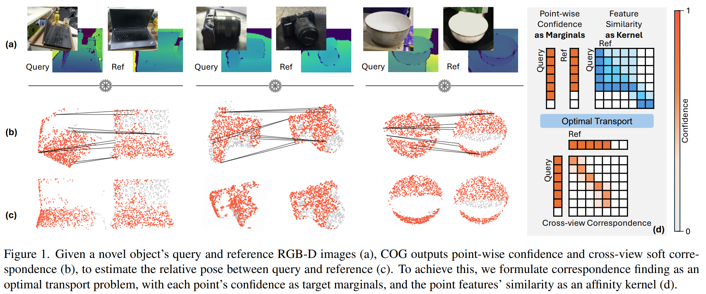

# COG: Confidence-aware Optimal Geometric Correspondence for Unsupervised Single-reference Novel Object Pose Estimation (CVPR2026)

This repo provides the implementation of COG, an unsupervised model for single-reference novel object poes estimation.
Available at [arxiv](https://arxiv.org/abs/2603.00493).


## Dependencies

```bash
conda create --name cog python=3.10.12
conda activate cog
pip install torch==2.2.0 torchvision==0.17.0 --index-url https://download.pytorch.org/whl/cu118  # use the correct version of cuda for your system
pip install mmcv==2.2.0 -f https://download.openmmlab.com/mmcv/dist/cu118/torch2.2/index.html # change cuda version if necessary

# Other required packages
pip install -r requirements.txt

# install bop toolkit for evaluation
cd third_party/bop_toolkit
python setup.py install
cd -

# build pointnet2 extension
cd core/COG/model/pointnet2/
pip install -e .
cd -

# Install Detectron2 & PyTorch3D
pip install "git+https://github.com/facebookresearch/detectron2.git"
pip install "git+https://github.com/facebookresearch/pytorch3d.git"

# Create output directory
mkdir output
```

## Datasets

Please refer to [UnoPose](https://github.com/shanice-l/UNOPose) for instructions on downloading the dataset files.

## Checkpoints

**Download DINOv2 checkpoint:** Download `'timm_vit_base_patch14_reg4_dinov2_lvd142m.pth'` and place it in `checkpoints/`:

```bash
# export HF_ENDPOINT="https://hf-mirror.com"  # if huggingface.co is not accessible
python core/COG/scripts/download_and_save_dinov2_ckpt.py
```

**Download COG checkpoint:** Download it from [model weights](https://drive.google.com/file/d/12Y6DRl3y39GxLL2rQJwM4ieWRwZUnk1c/view?usp=sharing).

## Reproduce the results

**Eval**

```bash
./core/COG/save_cog.sh configs/main_cfg.py <gpu_ids> <ckpt_path> (other args)
```

**Notice:** To change the evaluation dataset, `ref_targets_name`, `eval_dataset_name`, and `detetion_path` in the config file need to be replaced. Please search for these parameters in `configs/main_cfg.py`.

**Training**

```bash
./core/COG/dp_train_cog.sh configs/main_cfg.py <gpu_ids> (other args)
```

## Citation

If you find this repo useful in your research, please consider citing:

```
@InProceedings{che2026cog,
      title={COG: Confidence-aware Optimal Geometric Correspondence for Unsupervised Single-reference Novel Object Pose Estimation}, 
      author={Yuchen Che and Jingtu Wu and Hao Zheng and Asako Kanezaki},
      booktitle={CVPR},
      year={2026}
}
```

## Acknowledgments

This work is based on [UnoPose](https://github.com/shanice-l/UNOPose). We thank the authors for their insightful work.
